<p align="center">
  
</p>

<p align="center">
  <a href="https://orkmeter.com"><b>orkmeter.com</b></a> &nbsp;·&nbsp;
  <a href="https://orkestera.com"><b>orkestera.com</b></a> &nbsp;·&nbsp;
  <a href="https://edos.io"><b>edos.io</b></a>
</p>

---

EDOS builds tools for teams that work with AI coding agents: Ork Meter to see and cut what the agents spend, and Orkestera to run agent work you can review and audit.

## Ork Meter

**Count every token, make every token count.** [orkmeter.com](https://orkmeter.com)

Ork Meter tracks your Claude Code and Codex usage in one live dashboard. **Ork Meter Plus** adds a plugin that trims noisy tool output before the agent reads it. Free to meter. No card. Only usage numbers leave your machine.

In our benchmark, Plus used 29.3% fewer non-cached tokens across 1,524 heavy-output task attempts. ([Benchmark data](https://orkmeter.com/#benchmark))

**Install** ([full guide](https://orkmeter.com/install)):

```text
# Claude Code 2.1.280 or later
claude plugin marketplace add https://orkmeter.com/releases/claude/marketplace.json
claude plugin install ork-meter@edos
# then run /ork-meter:connect and restart Claude Code once

# Codex
codex plugin marketplace add EDOS-Engineering/ork-meter-codex
codex plugin add ork-meter-codex@edos-codex
# then run setup once, as shown at orkmeter.com/install
```

## Orkestera

**Autonomy you can audit.** [orkestera.com](https://orkestera.com)

Give work a goal. Follow its progress, review the result, and inspect the usage it records. Describe the work in Ork Chat; Orkestera breaks it into issues and runs it on its two core services:

- **GraphAgent** runs each workflow as a directed graph of plugin nodes, in an isolated workspace, checkpointing every node to a durable journal it can resume from.
- **LLMProxy** routes GraphAgent's model calls to your configured provider and records model, usage and attribution, so cost lands against the work.

Successful delivery opens a pull request on a separate branch. Orkestera is in active development with design partners. Run it on your own infrastructure and shape what ships next: [become a design partner](https://orkestera.com).

## Public repositories

| Repository | What it is |
|---|---|
| [ork-meter-claude](https://github.com/EDOS-Engineering/ork-meter-claude) | Ork Meter plugin for Claude Code |
| [ork-meter-codex](https://github.com/EDOS-Engineering/ork-meter-codex) | Ork Meter installer for the Codex CLI |
| [orkestera-starter](https://github.com/Orkestera-Sandboxes/orkestera-starter) | Template repository for your first Orkestera task |
| [reverb-marketplace](https://github.com/EDOS-Engineering/reverb-marketplace) | PHP and Laravel client for the Reverb.com marketplace API |
| [rackoon-tycoon](https://github.com/EDOS-Engineering/rackoon-tycoon) | AWS Solutions Architect study guide and browser game |

## Contact

[info@edos.io](mailto:info@edos.io) · Ork Meter support: [edos-labs@edos.io](mailto:edos-labs@edos.io) · Boise, Idaho

---

<p align="center"><sub>Enterprise DevOps Solutions LLC</sub></p>
